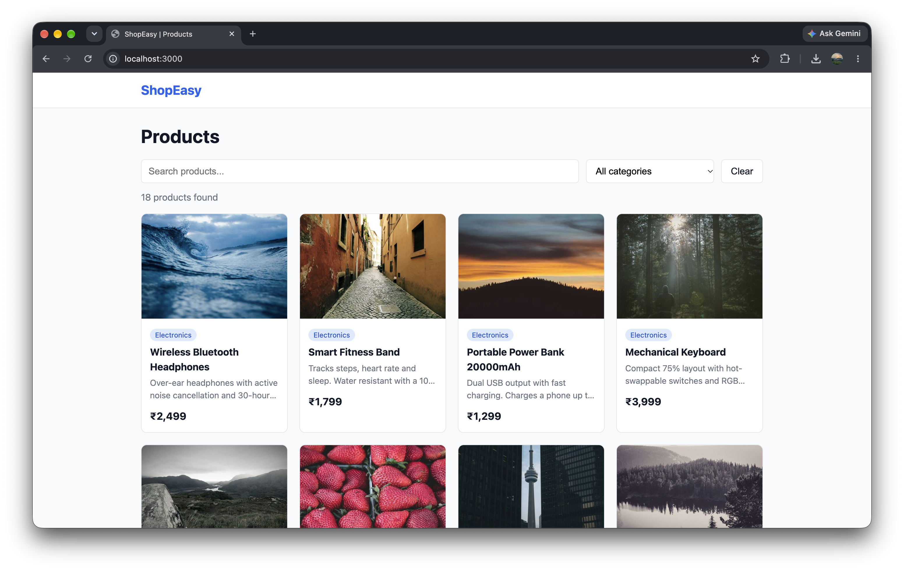
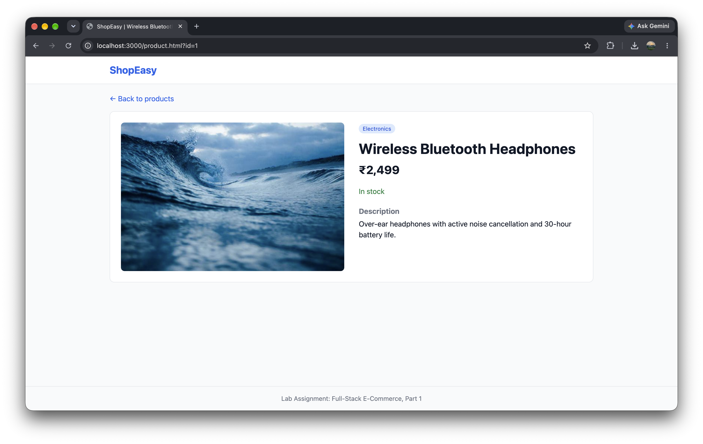

# ShopEasy: Full-Stack E-Commerce Application

**Part 1: Product Listing Website**

A product listing website where users can browse products, search, filter by category, and view product details. The frontend (HTML/CSS/JavaScript), backend (Node.js + Express) and relational database (SQLite) run together as a single application on one computer.

## Features

- Product listing with name, description, price and image
- Search by name or description, and filter by category
- Pagination
- Product details page
- REST API with request validation and proper HTTP status codes
- Relational database (SQLite) managed with migrations and seed data
- Loading, empty and error states in the UI

## Tech Stack

| Layer | Technology |
|---|---|
| Frontend | HTML, CSS, vanilla JavaScript (ES modules, no build step) |
| Backend | Node.js, Express |
| Validation | zod |
| Database | SQLite (via `better-sqlite3`) |
| Migrations and queries | Knex |

## Screenshots

| Product listing | Product details |
|---|---|
|  |  |

## Prerequisites

- **Node.js** v20 or higher (LTS recommended): https://nodejs.org
- **npm** (included with Node.js)
- **Git**
- Internet access is needed only to show the sample product images (they load from `picsum.photos`). Without it the app still works and shows a placeholder image.

Check your versions:

```bash
node -v
npm -v
```

No separate database installation is needed. SQLite is embedded and stored in a single file.

## Setup and Run

```bash
# 1. Clone the repository
git clone https://github.com/hkp4064/ecommerce-app.git
cd ecommerce-app

# 2. Install dependencies
npm install

# 3. Create the configuration file
cp .env.example .env          # Windows (cmd/PowerShell): copy .env.example .env

# 4. Create the database tables and load the sample products
npm run db:setup

# 5. Start the application
npm start
```

Open **http://localhost:3000** in your browser.

The frontend and the API are served by the same Express server on one port, so there is nothing else to start.

## Configuration

Settings are read from the `.env` file (copy of `.env.example`):

| Variable | Default | Description |
|---|---|---|
| `PORT` | `3000` | Port the server listens on |
| `DB_FILE` | `./data.sqlite` | Path of the SQLite database file |

## Available Commands

| Command | Description |
|---|---|
| `npm start` | Start the server |
| `npm run dev` | Start the server with auto-restart on file changes (nodemon) |
| `npm run migrate` | Create or update database tables |
| `npm run seed` | Reload the sample data (replaces existing products and categories) |
| `npm run db:setup` | Run migrations and then seed data |

To reset the database completely, delete `data.sqlite` and run `npm run db:setup` again.

## Architecture

```
Browser (HTML/CSS/JS)  -->  Express server (:3000)  -->  Service layer  -->  SQLite
  served as static           /api/* routes              (Knex queries)       data.sqlite
  files by Express
```

- The **frontend** is a set of static files in `frontend/`. It never accesses the database. All data comes from the backend through `fetch` calls to `/api/...` (wrapped in `frontend/js/api.js`).
- The **backend** is organised in layers, each with a single responsibility:
  - **Routes** map URLs to controllers.
  - **Controllers** handle the request and response.
  - **Validators** (zod) check query parameters and path parameters. Invalid input results in a `400` response.
  - **Services** contain all database queries (Knex).
  - **Middleware** provides central error handling (one JSON error shape) and a JSON 404 for unknown API routes.
- The **database** schema is created by a Knex migration (`db/migrations/`) and populated by a seed file (`db/seeds/`). A plain SQL copy of the schema is in `db/schema.sql`.

## Database Schema

**categories**

| Column | Type | Notes |
|---|---|---|
| id | INTEGER | Primary key |
| name | VARCHAR(100) | Unique, not null |

**products**

| Column | Type | Notes |
|---|---|---|
| id | INTEGER | Primary key |
| name | VARCHAR(200) | Not null, indexed |
| description | TEXT | Not null |
| price | DECIMAL(10,2) | Not null, must be greater than 0 |
| image_url | VARCHAR(500) | Not null |
| category_id | INTEGER | Foreign key to `categories.id`, indexed |
| stock | INTEGER | Not null, default 0 |
| created_at | TIMESTAMP | Defaults to the current time |

The sample data contains 18 products across 5 categories (Electronics, Books, Clothing, Home & Kitchen, Sports & Outdoors). Prices are in INR.

## API Endpoints

Base URL: `http://localhost:3000`

| Method | Endpoint | Description | Status codes |
|---|---|---|---|
| GET | `/api/health` | Health check | 200 |
| GET | `/api/products` | List products (with search, filter, pagination) | 200, 400 |
| GET | `/api/products/:id` | Get one product | 200, 400, 404 |
| GET | `/api/categories` | List categories | 200 |

### `GET /api/products`

Query parameters (all optional):

| Parameter | Type | Default | Description |
|---|---|---|---|
| `search` | string (max 100) | none | Matches product name or description |
| `category` | positive integer | none | Category id |
| `page` | integer >= 1 | 1 | Page number |
| `limit` | integer 1 to 50 | 12 | Products per page |

Example: `GET /api/products?search=yoga&page=1&limit=8`

```json
{
  "data": [
    {
      "id": 16,
      "name": "Yoga Mat 6mm",
      "description": "Non-slip, cushioned yoga mat with a carry strap.",
      "price": 699,
      "image_url": "https://picsum.photos/seed/yogamat/600/400",
      "stock": 100,
      "category_id": 5,
      "category": "Sports & Outdoors"
    }
  ],
  "pagination": { "page": 1, "limit": 8, "total": 1, "totalPages": 1 }
}
```

### `GET /api/products/:id`

Returns a single product object (same fields as above).

### `GET /api/categories`

```json
[
  { "id": 2, "name": "Books" },
  { "id": 3, "name": "Clothing" }
]
```

### Error format

All errors use the same shape:

```json
{ "error": "Product with id 999 not found" }
```

| Status | When |
|---|---|
| 400 | Invalid query parameter or product id (for example `/api/products/abc`, `?limit=1000`, `?page=0`) |
| 404 | Product not found, or unknown `/api/...` route |
| 500 | Unexpected server error (details are logged on the server, not sent to the client) |

## Testing the API

```bash
curl http://localhost:3000/api/health
curl "http://localhost:3000/api/products?category=2"
curl "http://localhost:3000/api/products/1"
curl -i "http://localhost:3000/api/products/999"     # 404
curl -i "http://localhost:3000/api/products/abc"     # 400
```

On Windows PowerShell use `curl.exe` instead of `curl`, or open the URLs in a browser.

## Project Structure

```
ecommerce-app/
├── README.md
├── package.json
├── knexfile.js                  # Knex / database configuration
├── .env.example                 # Configuration template
├── db/
│   ├── migrations/              # Table creation (Knex)
│   ├── seeds/                   # Sample products and categories
│   └── schema.sql               # Plain SQL copy of the schema
├── backend/
│   ├── server.js                # Starts the server
│   ├── app.js                   # Express setup and routes
│   ├── db.js                    # Database connection
│   ├── routes/                  # URL to controller mapping
│   ├── controllers/             # Request and response handling
│   ├── services/                # Database queries
│   ├── validators/              # Input validation (zod)
│   └── middleware/              # Error handling
├── frontend/
│   ├── index.html               # Product listing page
│   ├── product.html             # Product details page
│   ├── css/style.css
│   └── js/                      # api.js, utils.js, listing.js, product.js
└── docs/screenshots/            # Screenshots used in this README
```

## Troubleshooting

| Problem | Fix |
|---|---|
| `no such table: products` | Run `npm run db:setup` |
| Product list is empty | Run `npm run seed` |
| `EADDRINUSE` (port in use) | Change `PORT` in `.env` |
| Blank page with module errors in the console | Open http://localhost:3000, do not open the HTML files directly |
| `better-sqlite3` install error | Use Node.js LTS (v20 or higher) and run `npm install` again |
| Images show "No image" | The sample images need internet access |
