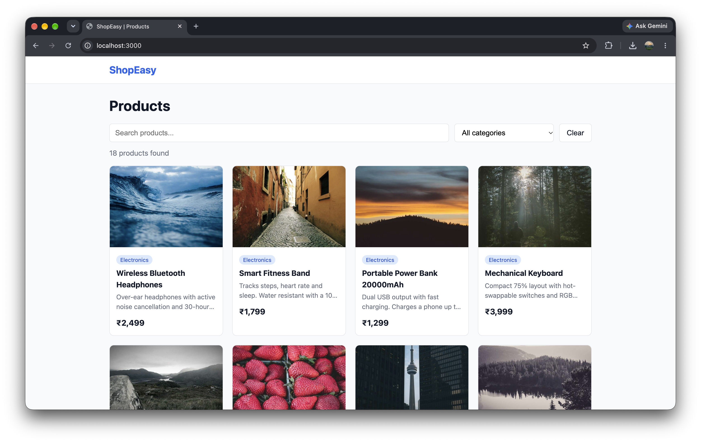
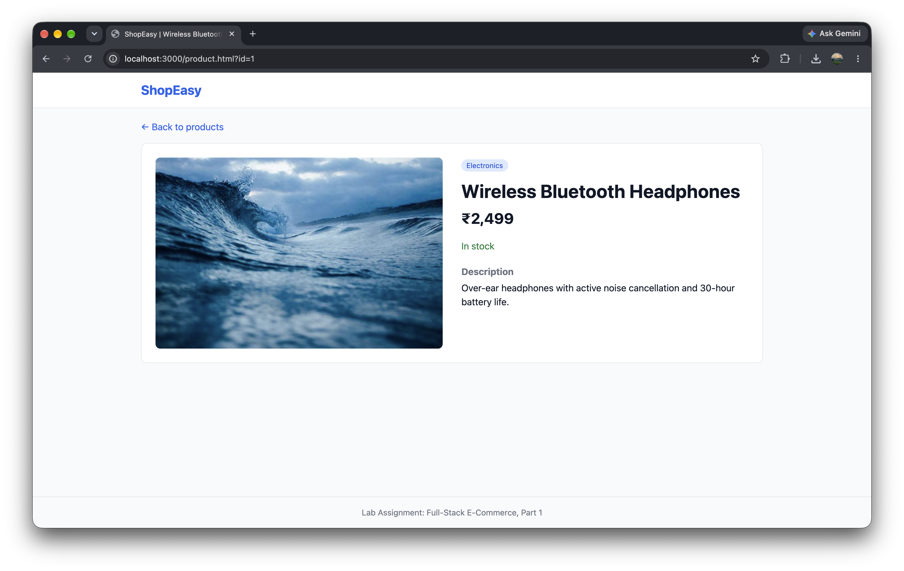

# ShopEasy: Full-Stack E-Commerce Application

**Part 1:** Product listing website
**Part 2:** User accounts, authentication and shopping cart
**Part 3:** Structured logging and monitoring (Prometheus + Grafana)

Browse products, search, filter by category and view details. Registered users can log in, keep a personal shopping cart and see server-calculated totals. The application writes structured logs and exposes metrics that are collected by Prometheus and shown in a Grafana dashboard.

The frontend (HTML/CSS/JavaScript), backend (Node.js + Express) and relational database (SQLite) run together as a single application on one computer. Docker is needed only for the optional monitoring stack (Part 3).

## Features

**Part 1: Products**
- Product listing with name, description, price and image
- Search by name or description, filter by category, pagination
- Product details page
- REST API with request validation and proper HTTP status codes
- Loading, empty and error states in the UI

**Part 2: Accounts and cart**
- Registration, login, logout, and a "current user" endpoint
- Session-based authentication (httpOnly cookie, sessions stored in the database)
- Passwords hashed with bcrypt, login rate limiting, security headers
- Per-user shopping cart: add, change quantity, remove
- Stock and quantity validation; cart totals always calculated on the server
- Database migrations that preserve existing products
- Script that demonstrates one user cannot access another user's cart

**Part 3: Logging and monitoring**
- Structured JSON logs (pino) with request IDs and redaction of passwords and cookies
- Prometheus metrics at `/metrics` (HTTP, cart, authentication, Node.js runtime)
- Prometheus + Grafana started with one command (Docker Compose), with a pre-provisioned dashboard
- Controlled failure and latency endpoints, plus a traffic generator, to demonstrate monitoring

## Tech Stack

| Layer | Technology |
|---|---|
| Frontend | HTML, CSS, vanilla JavaScript (ES modules, no build step) |
| Backend | Node.js, Express 5 |
| Validation | zod |
| Database | SQLite (via `better-sqlite3`) |
| Migrations and queries | Knex |
| Authentication | `express-session` with `connect-session-knex` (database-backed sessions) |
| Password hashing | `bcryptjs` |
| Security | `helmet`, `express-rate-limit` |
| Logging | `pino`, `pino-http` |
| Metrics | `prom-client` |
| Monitoring | Prometheus and Grafana (Docker Compose) |

## Screenshots

| Product listing | Product details |
|---|---|
|  |  |

Add the Part 2 and Part 3 screenshots to `docs/screenshots/` and reference them here (login/register, cart page, Grafana dashboard under normal traffic, Grafana dashboard during the failure demonstration).

## Prerequisites

- **Node.js** v20 or higher (LTS recommended): https://nodejs.org
- **npm** (included with Node.js)
- **Git**
- **Docker Desktop** (only for the monitoring stack in Part 3): https://www.docker.com/products/docker-desktop
- Internet access is needed only to show the sample product images (they load from `picsum.photos`). Without it the app still works and shows a placeholder image.

Check your versions:

```bash
node -v
npm -v
docker --version
```

No separate database installation is needed. SQLite is embedded and stored in a single file.

## Setup and Run

```bash
# 1. Clone the repository
git clone https://github.com/hkp4064/ecommerce-app.git
cd ecommerce-app

# 2. Install dependencies
npm install

# 3. Create the configuration file
cp .env.example .env          # Windows (cmd/PowerShell): copy .env.example .env

# 4. Create the database tables and load the sample products
npm run db:setup

# 5. Start the application
npm start
```

Open **http://localhost:3000** in your browser. Register an account to use the cart.

The frontend and the API are served by the same Express server on one port, so there is nothing else to start for Parts 1 and 2.

### Start the monitoring stack (Part 3)

With the application running, in a second terminal:

```bash
docker compose up -d
```

| Service | URL | Login |
|---|---|---|
| Application | http://localhost:3000 | register an account |
| Metrics (raw) | http://localhost:3000/metrics | none |
| Prometheus | http://localhost:9090 (targets: http://localhost:9090/targets) | none |
| Grafana | http://localhost:3001 | `admin` / `admin` |

Grafana opens directly on the **E-commerce App Overview** dashboard. The data source and dashboard are provisioned from files in `monitoring/`, so no manual setup is needed. Stop the stack with `docker compose down`.

### Upgrading an existing database

If you already have a database from Part 1, **do not** use `db:setup`. Run:

```bash
npm run migrate
```

The new migrations only add tables (users, carts, cart items, sessions) and keep all existing products and categories. The seed script inserts sample data only when the tables are empty, so re-running it never deletes data. Verify this with:

```bash
npm run verify:migration
```

## Configuration

Settings are read from the `.env` file (copy of `.env.example`). Variables used by the application include:

| Variable | Default | Description |
|---|---|---|
| `PORT` | `3000` | Port the server listens on |
| `DB_FILE` | `./data.sqlite` | Path of the SQLite database file |
| `ENABLE_FAILURE_DEMO` | `false` | When `true`, enables `/api/debug/fail` and `/api/debug/slow` (demonstration only; never enable in production) |

See `.env.example` for the complete list, including session and logging settings.

## Available Commands

| Command | Description |
|---|---|
| `npm start` | Start the server |
| `npm run dev` | Start the server with auto-restart on file changes (nodemon) |
| `npm run dev:pretty` | Same, with human-readable logs (pino-pretty) |
| `npm run migrate` | Create or update database tables (keeps existing data) |
| `npm run migrate:status` | Show which migrations have run |
| `npm run migrate:rollback` | Undo the latest migration batch |
| `npm run seed` | Load sample products and categories (only if the tables are empty) |
| `npm run db:setup` | Run migrations and then seed data (use on a new database) |
| `npm run verify:migration` | Prove that existing products survive the migrations |
| `npm run test:auth` | Smoke test for registration, login, logout |
| `npm run test:cart` | Smoke test for the cart endpoints |
| `npm run demo:authz` | Demonstrate that one user cannot access another user's cart |
| `npm run demo:logging` | Generate sample log events (including errors) |
| `npm run demo:traffic -- 90` | Generate 90 seconds of mixed traffic for the dashboard demo |
| `npm run show:users` | List registered users (never shows password hashes) |

To reset the database completely, delete `data.sqlite` and run `npm run db:setup` again.

## Architecture

```
Browser ──> Express (:3000) ──> Services ──> SQLite
              │  middleware: request ID, logging, metrics, session, auth
              ├─ structured JSON logs (stdout)
              └─ GET /metrics <── Prometheus (:9090) ──> Grafana (:3001)
```

- The **frontend** is a set of static files in `frontend/`. It never accesses the database. All data comes from the backend through `fetch` calls to `/api/...`.
- The **backend** is organised in layers, each with a single responsibility:
  - **Routes** map URLs to controllers.
  - **Controllers** handle the request and response.
  - **Validators** (zod) check request bodies, query parameters and path parameters. Invalid input results in a `400` response.
  - **Services** contain all database queries (Knex) and business rules (stock checks, totals, authorization).
  - **Middleware** provides request logging, metrics, sessions, authentication (`requireAuth`), central error handling (one JSON error shape) and a JSON 404 for unknown API routes.
- The **database** schema is created by Knex migrations (`db/migrations/`) and populated by a seed file (`db/seeds/`). A plain SQL copy of the schema is in `db/schema.sql`.

### Architecture decisions

| Decision | Reason |
|---|---|
| **Session cookies instead of JWT** | The session ID is stored in an `httpOnly` cookie, so frontend JavaScript never handles or stores tokens. Logout really ends the session on the server. Sessions live in SQLite and survive restarts. |
| **bcryptjs for passwords** | Salted, deliberately slow hashing. Pure JavaScript, so there are no native build problems on any operating system. A dummy hash is compared when the email does not exist, so login timing does not reveal which emails are registered. |
| **Cart is found from the session, never from the request** | The cart is always looked up from `req.session.userId`. Item routes also filter by the user's own `cart_id`, so another user's item id simply returns 404. |
| **Prices are not stored in the cart** | Totals are calculated by joining `cart_items` with `products`, in integer cents to avoid floating-point errors. A client can never submit or change a price. |
| **Cart changes run in transactions** | Stock and quantity are checked and the change is applied together, so concurrent requests cannot leave the cart in an inconsistent state. |
| **Layered structure and Knex migrations** | Parts 2 and 3 were added without rewriting Part 1. |
| **Route patterns as metric labels** | Metrics use `/api/products/:id`, not `/api/products/17`, so the number of time series stays small. |
| **Provisioned Grafana** | Data source and dashboard are files in the repository, so a clean clone works with zero manual clicking. |
| **Failure demo behind a flag** | Debug endpoints exist only when `ENABLE_FAILURE_DEMO=true`. |

## Database Schema

**categories**

| Column | Type | Notes |
|---|---|---|
| id | INTEGER | Primary key |
| name | VARCHAR(100) | Unique, not null |

**products**

| Column | Type | Notes |
|---|---|---|
| id | INTEGER | Primary key |
| name | VARCHAR(200) | Not null, indexed |
| description | TEXT | Not null |
| price | DECIMAL(10,2) | Not null, must be greater than 0 |
| image_url | VARCHAR(500) | Not null |
| category_id | INTEGER | Foreign key to `categories.id`, indexed |
| stock | INTEGER | Not null, default 0 |
| created_at | TIMESTAMP | Defaults to the current time |

**users**

| Column | Type | Notes |
|---|---|---|
| id | INTEGER | Primary key |
| email | VARCHAR | Unique, not null |
| name | VARCHAR | Not null |
| password_hash | VARCHAR | bcrypt hash, never returned by the API |
| created_at | TIMESTAMP | Defaults to the current time |

**carts** (one cart per user)

| Column | Type | Notes |
|---|---|---|
| id | INTEGER | Primary key |
| user_id | INTEGER | Unique foreign key to `users.id` |
| created_at, updated_at | TIMESTAMP | |

**cart_items**

| Column | Type | Notes |
|---|---|---|
| id | INTEGER | Primary key |
| cart_id | INTEGER | Foreign key to `carts.id` |
| product_id | INTEGER | Foreign key to `products.id` |
| quantity | INTEGER | Must be greater than 0 |

Unique on (`cart_id`, `product_id`): adding the same product again increases the quantity.

**sessions** is created by the session store (`sid`, `sess`, `expired`).

The sample data contains 18 products across 5 categories (Electronics, Books, Clothing, Home & Kitchen, Sports & Outdoors). Prices are in INR.

## API Endpoints

Base URL: `http://localhost:3000`

### Products and categories (public)

| Method | Endpoint | Description | Status codes |
|---|---|---|---|
| GET | `/api/health` | Health check | 200 |
| GET | `/api/products` | List products (search, filter, pagination) | 200, 400 |
| GET | `/api/products/:id` | Get one product | 200, 400, 404 |
| GET | `/api/categories` | List categories | 200 |

### Authentication

| Method | Endpoint | Auth required | Description | Status codes |
|---|---|---|---|---|
| POST | `/api/auth/register` | no | Create an account | 201, 400, 409 (email exists) |
| POST | `/api/auth/login` | no | Log in (rate limited) | 200, 400, 401, 429 |
| POST | `/api/auth/logout` | yes | End the session | 200, 401 |
| GET | `/api/auth/me` | yes | Current user | 200, 401 |

Registration body: `{ "email": "...", "name": "...", "password": "..." }`. Login body: `{ "email": "...", "password": "..." }`. Login returns the same `401` message for an unknown email and a wrong password.

### Cart (all require login)

| Method | Endpoint | Description | Status codes |
|---|---|---|---|
| GET | `/api/cart` | Cart items and server-calculated total | 200, 401 |
| POST | `/api/cart/items` | Add a product `{ "productId": 1, "quantity": 2 }` | 200, 400, 401, 404 (no such product), 409 (stock or limit) |
| PATCH | `/api/cart/items/:itemId` | Change quantity `{ "quantity": 3 }` | 200, 400, 401, 404, 409 |
| DELETE | `/api/cart/items/:itemId` | Remove an item | 200, 401, 404 |

Example `GET /api/cart` response:

```json
{
  "items": [
    {
      "id": 4,
      "product_id": 16,
      "name": "Yoga Mat 6mm",
      "image_url": "https://picsum.photos/seed/yogamat/600/400",
      "unit_price": 699,
      "stock": 100,
      "quantity": 2,
      "line_total": 1398
    }
  ],
  "item_count": 2,
  "total": 1398
}
```

### Monitoring and demo

| Method | Endpoint | Description |
|---|---|---|
| GET | `/metrics` | Prometheus metrics (not part of the public API) |
| GET | `/api/debug/fail` | Returns a 500 (only when `ENABLE_FAILURE_DEMO=true`) |
| GET | `/api/debug/slow?ms=1500` | Delayed response, max 5000 ms (only when `ENABLE_FAILURE_DEMO=true`) |

### `GET /api/products`

Query parameters (all optional):

| Parameter | Type | Default | Description |
|---|---|---|---|
| `search` | string (max 100) | none | Matches product name or description |
| `category` | positive integer | none | Category id |
| `page` | integer >= 1 | 1 | Page number |
| `limit` | integer 1 to 50 | 12 | Products per page |

Example: `GET /api/products?search=yoga&page=1&limit=8`

```json
{
  "data": [
    {
      "id": 16,
      "name": "Yoga Mat 6mm",
      "description": "Non-slip, cushioned yoga mat with a carry strap.",
      "price": 699,
      "image_url": "https://picsum.photos/seed/yogamat/600/400",
      "stock": 100,
      "category_id": 5,
      "category": "Sports & Outdoors"
    }
  ],
  "pagination": { "page": 1, "limit": 8, "total": 1, "totalPages": 1 }
}
```

### Error format

All errors use the same shape:

```json
{ "error": "Product with id 999 not found" }
```

| Status | When |
|---|---|
| 400 | Invalid body, query parameter or id (for example `/api/products/abc`, `?limit=1000`) |
| 401 | Not logged in, or wrong email or password |
| 404 | Product or cart item not found (including another user's item), or unknown `/api/...` route |
| 409 | Email already registered, product out of stock, or quantity above stock or the per-product limit |
| 429 | Too many login attempts |
| 500 | Unexpected server error (details are logged on the server, not sent to the client) |

## Security

- Passwords are hashed with bcrypt (cost factor 12) and never logged or returned.
- The session cookie is `httpOnly`; sessions are stored server-side in SQLite.
- Login is rate limited to slow down brute-force attempts.
- `helmet` sets security headers, including a Content Security Policy.
- All input is validated with zod; request bodies are limited to 10 kB.
- Authorization: a user can only ever read or change their own cart. Run `npm run demo:authz` to see two users trying to access each other's items (the other user's item returns 404).
- Prices and totals are computed on the server.
- Logs redact passwords and cookies (see Logging).

## Logging

The application uses `pino` and `pino-http`. Every log line is one JSON object, which makes logs searchable and ready for a log platform.

- **Request logging:** every request is logged with method, URL, status code and response time.
- **Request IDs:** each request gets an ID that appears on all log lines for that request, so one request can be followed from start to finish.
- **Redaction:** passwords, cookies and authorization headers are replaced with `[Redacted]` and never reach the logs.
- **Events:** failed and successful logins, registration, and server and database errors are logged with the appropriate level (`info`, `warn`, `error`).

For readable logs during development, run `npm run dev:pretty`. Run `npm run demo:logging` to generate sample events.

## Monitoring

Prometheus scrapes `/metrics` every 5 seconds. Grafana reads from Prometheus.

### Metrics exposed

| Metric | Type | Labels |
|---|---|---|
| `http_requests_total` | Counter | method, route, status |
| `http_request_duration_seconds` | Histogram | method, route, status |
| `cart_operations_total` | Counter | operation (add, update, remove) |
| `cart_items_added_total` | Counter | none |
| `auth_attempts_total` | Counter | result (success, failure) |
| Default Node.js metrics | Process, memory, CPU, event loop | automatic |

The `route` label uses the route pattern (for example `/api/cart/items/:itemId`), not the raw URL, so it stays low-cardinality. Error rate is derived from `http_requests_total` filtered by status `4..` and `5..`.

### Dashboard panels

Request rate, latency percentiles (p50, p95, p99), error rate (4xx and 5xx), requests by route, cart operations, and login success vs failure.

### Controlled failure demonstration

1. Set `ENABLE_FAILURE_DEMO=true` in `.env` and restart the app (`npm run dev:pretty`).
2. Start the monitoring stack (`docker compose up -d`) and open Grafana at http://localhost:3001 (time range: last 5 minutes).
3. Run `npm run demo:traffic -- 90`.

The generator sends a mix of normal browsing, cart operations, failed logins, 404s, slow requests and 500 errors. In Grafana you will see the 5xx and 4xx lines rise, p95/p99 latency jump to about 1.5 seconds, and login failures appear next to successes. In the application terminal the simulated failure appears as an `error` log entry.

## Testing

```bash
curl http://localhost:3000/api/health
curl "http://localhost:3000/api/products?category=2"
curl -i "http://localhost:3000/api/products/999"     # 404
curl -i "http://localhost:3000/api/cart"             # 401 (not logged in)
curl http://localhost:3000/metrics
```

With the server running:

```bash
npm run test:auth
npm run test:cart
npm run demo:authz
```

On Windows PowerShell use `curl.exe` instead of `curl`, or open the URLs in a browser.

## Project Structure

```
ecommerce-app/
├── README.md
├── package.json
├── knexfile.js                  # Knex / database configuration
├── .env.example                 # Configuration template
├── docker-compose.yml           # Prometheus + Grafana
├── monitoring/
│   ├── prometheus/prometheus.yml
│   └── grafana/
│       ├── provisioning/        # data source + dashboard provider
│       └── dashboards/ecommerce.json
├── scripts/                     # smoke tests and demos (auth, cart, authz, logging, traffic, migration check)
├── db/
│   ├── migrations/              # Table creation (Knex)
│   ├── seeds/                   # Sample products and categories
│   └── schema.sql               # Plain SQL copy of the schema
├── backend/
│   ├── server.js                # Starts the server
│   ├── app.js                   # Express setup and routes
│   ├── db.js                    # Database connection
│   ├── logger.js                # pino configuration and redaction
│   ├── metrics.js               # prom-client registry and metrics
│   ├── routes/                  # products, categories, auth, cart, debug
│   ├── controllers/             # Request and response handling
│   ├── services/                # Database queries and business rules
│   ├── validators/              # Input validation (zod)
│   └── middleware/              # session, requireAuth, requestLogger, metrics, error handling
├── frontend/
│   ├── index.html               # Product listing page
│   ├── product.html             # Product details page
│   ├── login.html, register.html, cart.html
│   ├── css/style.css
│   └── js/                      # api.js, utils.js, listing.js, product.js, auth.js, cart.js, nav.js
└── docs/screenshots/            # Screenshots used in this README
```

## Troubleshooting

| Problem | Fix |
|---|---|
| `no such table: products` or `users` | Run `npm run migrate` (new database: `npm run db:setup`) |
| Product list is empty | Run `npm run seed` |
| `EADDRINUSE` (port in use) | Change `PORT` in `.env` |
| Blank page with module errors in the console | Open http://localhost:3000, do not open the HTML files directly |
| `better-sqlite3` install error | Use Node.js LTS (v20 or higher) and run `npm install` again |
| Images show "No image" | The sample images need internet access |
| Prometheus target shows DOWN | Make sure the app is running on port 3000, then check http://localhost:9090/targets for the error |
| Grafana panels show "No data" | Set the time range to the last 5 minutes and generate traffic (`npm run demo:traffic -- 60`) |
| `/api/debug/...` returns 404 | Set `ENABLE_FAILURE_DEMO=true` in `.env` and restart the app |
| Port 9090 or 3001 already in use | Change the left side of the port mapping in `docker-compose.yml` |
| Login returns 429 | Too many attempts; wait a few minutes and try again |
